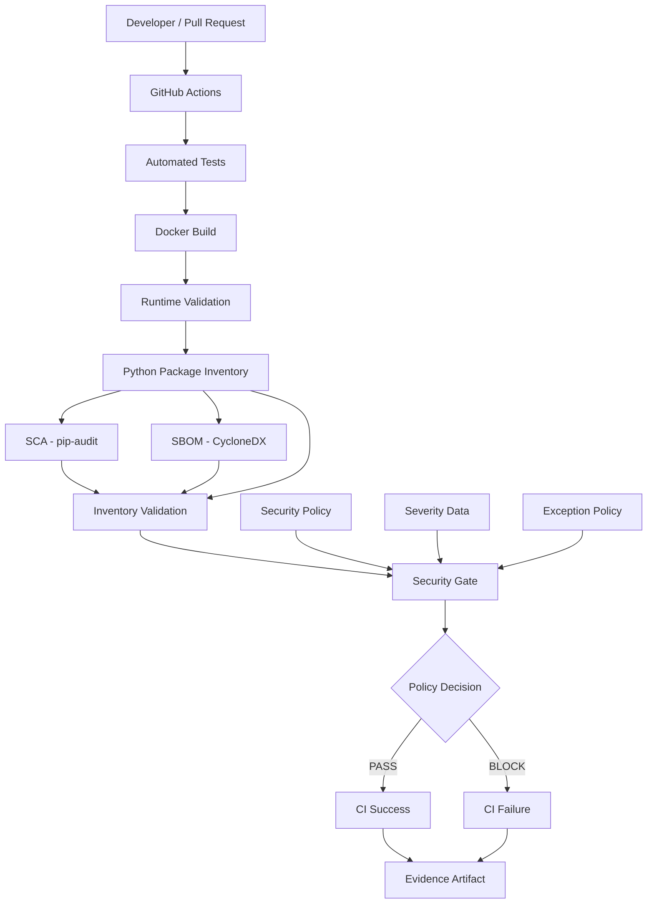

# OSS Security Gate

> Policy-driven Software Supply Chain Security
>
> SCA, SBOM, 보안 정책 및 CI/CD를 활용한
> 오픈소스 소프트웨어 공급망 보안 자동화 프로젝트

## 1. 프로젝트 개요

오픈소스 소프트웨어 사용 과정에서 발생하는
알려진 취약점을 식별하고, 보안 정책에 따라
CI/CD 단계에서 배포 적합성을 평가하는
Security Gate를 구현하였다.

본 프로젝트는 금융권 오픈소스 보안 관리 업무를
고려하여 설계한 개인 학습용 PoC이다.
실제 금융기관의 내부 시스템, 데이터 및 보안 정책을
사용하지 않았다.

## 2. 프로젝트 추진 배경

- 직접 의존성뿐만 아니라 전이 의존성에서도
  보안 취약점이 발생할 수 있다.
- 개발 환경과 실제 실행 환경의 패키지 구성이
  다를 수 있다.
- 취약점 탐지만으로는 실질적인 보안 통제가 어렵다.
- 취약점 조치 및 예외 승인 과정의 추적성이 필요하다.
- 개발 초기 단계에서 보안 검증을 수행하는
  Shift Left 체계가 필요하다.

## 3. 프로젝트 목표

- 실제 컨테이너 실행 환경의 패키지 식별
- SCA 기반 알려진 취약점 탐지
- CycloneDX 기반 SBOM 생성
- 패키지 인벤토리, SCA, SBOM 정합성 검증
- 정책 기반 Security Gate 구현
- 승인 및 만료일 기반 취약점 예외 관리
- GitHub Actions 기반 보안 검증 자동화
- 취약점 조치 전후 비교 및 증적 관리

## 4. 주요 성과

| 검증 항목 | 조치 전 | 조치 후 |
|---|---:|---:|
| 컨테이너 Python 패키지 | 11 | 8 |
| 원본 취약점 탐지 레코드 | 56 | 0 |
| 중복 제거 후 탐지 레코드 | 29 | 0 |
| 검사 제외 패키지 | 0 | 0 |
| Security Gate | BLOCK | PASS |

중복 제거는 패키지명, 버전, 취약점 식별자를
기준으로 수행하였다.

29건은 서로 다른 CVE의 개수가 아니라
중복 제거 기준에 따른 고유 탐지 레코드 수이다.

동일한 보안 정책을 유지한 상태에서
의존성 업데이트 및 불필요한 패키지 제거를 수행하여
검사 시점 기준 알려진 Python 패키지 취약점의
탐지 레코드를 0건으로 감소시켰다.

자동화 테스트 31개를 통과하였다.

## 5. 시스템 아키텍처



## 6. 기술 스택

| 구분 | 기술 |
|---|---|
| 개발 언어 | Python |
| 실행 환경 | Docker |
| SCA | pip-audit |
| SBOM | CycloneDX |
| 정책 관리 | YAML |
| 검사 결과 | JSON |
| CI/CD | GitHub Actions |
| 테스트 | unittest |
| 형상 관리 | Git / GitHub |
| 공개 전 비밀정보 검사 | Gitleaks |

## 7. 실습 환경 및 주의사항

조치 전 Git 태그에는 보안 검증을 목적으로
의도적으로 취약한 의존성이 포함되어 있다.

해당 버전을 실제 서비스에 배포하거나
외부 네트워크에 노출하지 않아야 한다.

실습 애플리케이션은 실제 금융 거래 및
고객정보를 처리하지 않는다.

본 프로젝트는 학습 및 기술 검증을 목적으로 하며,
실제 운영 환경에 적용하기 위한 추가적인
보안 검토가 필요하다.

## 8. 기술적 한계

- Python 패키지의 알려진 취약점을 검사하며,
  OS 패키지 전체의 보안 검증은 포함하지 않는다.
- 취약점 데이터베이스의 최신성과 정확성에 의존한다.
- 취약점 미탐지가 모든 보안 위험의 부재를
  의미하지 않는다.
- 실제 공격 재현 및 전체 소스코드 취약점 검증은
  수행하지 않았다.
- 상용 SCA 솔루션과 직접 연동하지 않았다.
- 운영 환경의 배포 및 승인 체계는 추가 검증이
  필요하다.


## 9. 주요 보안 기능

### 9.1. 실제 실행 환경 기반 SCA

requirements.txt에 선언된 직접 의존성뿐만 아니라
Docker 컨테이너에 실제 설치된 Python 패키지를
대상으로 취약점 검사를 수행하였다.

직접 의존성, 전이 의존성 및 빌드 관련 패키지를
구분하여 분석함으로써 선언된 의존성만 검사할 때
발생할 수 있는 사각지대를 확인하였다.

### 9.2. 취약점 탐지 결과 정규화

SCA 결과에서 패키지명, 버전, 취약점 식별자를
기준으로 중복 레코드를 제거하였다.

패키지명 정규화 및 취약점 별칭 처리를 통해
정책 평가에 활용할 수 있는 데이터 구조를 구성하였다.

다만 서로 다른 취약점 식별자가 동일한 CVE를
참조하는 경우까지 완전히 통합하지는 않는다.

### 9.3. SBOM 생성 및 정합성 검증

CycloneDX 1.6 형식의 SBOM을 생성하였다.

컨테이너 패키지 인벤토리, SCA 검사 결과,
SBOM의 패키지명과 버전을 비교하여
검사 대상의 누락 및 불일치 여부를 검증하였다.

정합성 검증은 식별된 Python 패키지 집합을
대상으로 하며 전체 소프트웨어 구성요소의
완전성을 보장하지는 않는다.

### 9.4. 정책 기반 Security Gate

취약점 심각도에 따라 허용 또는 차단 여부를
결정하는 정책 평가 엔진을 구현하였다.

검사 결과가 유효하지 않거나 심각도를 확인할 수
없는 경우에도 보안 검증을 실패 처리하도록
Fail-Closed 방식으로 설계하였다.

### 9.5. 취약점 예외 관리

취약점의 즉각적인 조치가 어려운 상황을 고려하여
승인 기반 예외 관리 기능을 구현하였다.

예외 적용 시 패키지명, 버전, 취약점 식별자,
승인 상태, 담당자, 승인자, 승인일, 만료일,
예외 사유 및 보완 통제를 검증한다.

자기 승인, 만료된 예외, 중복 적용 가능한 예외는
허용하지 않도록 설계하였다.

### 9.6. CI/CD 기반 Shift Left

GitHub Actions를 활용하여 코드 변경 및
Pull Request 단계에서 보안 검증을 수행한다.

보안 정책 위반 시 Workflow를 실패 처리하고,
검사 결과와 SBOM 및 테스트 결과를
Artifact로 저장하도록 구성하였다.

현재 Workflow의 실패 처리는 검증되었으며,
브랜치 보호를 통한 강제 병합 차단은
별도 검증이 필요한 상태이다.

## 10. 보안 정책

| 심각도 | 기본 정책 | 예외 허용 |
|---|---|---|
| CRITICAL | BLOCK | 불가 |
| HIGH | BLOCK | 조건부 허용 |
| MEDIUM | BLOCK | 조건부 허용 |
| LOW | ALLOW | 해당 없음 |
| UNKNOWN | BLOCK | 불가 |

본 정책은 개인 프로젝트에서 설계한
보수적인 보안 정책이며 실제 금융기관의
보안 정책을 의미하지 않는다.

예외 승인 기간은 최대 30일로 제한하며,
Asia/Seoul 시간대를 기준으로 유효성을 검증한다.

### Security Gate 종료 코드

| Exit Code | 의미 |
|---|---|
| 0 | 정책 검증 통과 |
| 1 | 보안 정책 위반 |
| 2 | 입력 데이터 또는 설정 검증 오류 |

## 11. 취약점 조치 사례

| CVE | 패키지 | 취약점 유형 |
|---|---|---|
| CVE-2018-18074 | requests | 리다이렉트 과정의 인증정보 노출 |
| CVE-2024-35195 | requests | TLS 인증서 검증 관련 문제 |
| CVE-2020-14343 | PyYAML | 안전하지 않은 역직렬화 |

취약점 식별 이후 영향받는 버전, 수정 버전,
애플리케이션의 사용 방식 및 조치 방안을
검토하였다.

패키지 취약점의 존재와 실제 애플리케이션에서의
악용 가능성을 구분하여 분석하였다.

상세 분석은 reports/cve_triage.md에 기록하였다.

## 12. 의존성 개선 결과

| 패키지 | 조치 전 | 조치 후 |
|---|---|---|
| requests | 2.19.1 | 2.34.2 |
| PyYAML | 5.3 | 6.0.4 |
| urllib3 | 1.23 | 2.8.0 |
| idna | 2.7 | 3.20 |
| pip | 24.0 | 26.3 |
| setuptools | 79.0.1 | 제거 |
| Cython | 0.29.37 | 제거 |
| wheel | 0.46.3 | 제거 |

의존성 업데이트와 불필요한 빌드 관련 패키지
제거를 통해 실행 환경을 개선하였다.

보안 정책 완화 또는 취약점 예외 등록 없이
Security Gate의 BLOCK 상태를 PASS로 전환하였다.


## 13. 프로젝트 디렉터리 구조

- app/
  - sample_app.py: 보안 검증 대상 실습 애플리케이션
- scripts/
  - analyze_results.py: SCA 결과 분석 및 중복 제거
  - security_gate.py: 보안 정책 평가 엔진
  - exception_manager.py: 취약점 예외 검증
  - validate_sbom.py: SBOM 정합성 검증
  - validate_ci_inventory.py: 인벤토리 정합성 검증
- security/
  - policy.yaml: 심각도별 보안 정책
  - severity.yaml: 검증된 취약점 심각도 정보
  - exceptions.yaml: 취약점 예외 관리
  - scan_results/: SCA 검사 결과
- sbom/
  - initial_sbom.json: 초기 SBOM
  - remediated_sbom.json: 조치 후 SBOM
- tests/
  - 단위 테스트 및 통합 테스트
  - fixtures/: 테스트 입력 데이터
- reports/
  - CVE 분석 및 보안 검증 결과
- .github/workflows/
  - security-scan.yml: CI/CD 보안 검증
- Dockerfile: 애플리케이션 실행 환경 정의
- requirements.txt: 애플리케이션 의존성
- requirements-tools.txt: 보안 검사 도구 의존성

일부 스크립트와 정책의 이전 버전도 보존하여
보안 기능의 개선 과정을 추적할 수 있도록 하였다.


## 14. 실행 및 재현 방법

### 14.1. 사전 요구사항

- Python 3.13
- Docker
- Git

### 14.2. 보안 검사 환경 구성

```bash
git clone https://github.com/ornhnmn/oss-security-gate-portfolio.git
cd oss-security-gate-portfolio
python3.13 -m venv .venv-tools
source .venv-tools/bin/activate
python -m pip install -r requirements-tools.txt
python -m pip check
```

### 14.3. 자동화 테스트 실행

```bash
python -m unittest discover -s tests -v
```

### 14.4. Docker 이미지 빌드

```bash
docker build -t oss-security-gate:local .
```

### 14.5. 제한된 환경에서 실행

```bash
docker run --rm --network none --read-only --cap-drop ALL --security-opt no-new-privileges:true oss-security-gate:local
```

### 14.6. 기존 SCA 결과 분석

```bash
python scripts/analyze_results.py --scan security/scan_results/remediated_scan.json
```

### 14.7. 보안 정책 평가

```bash
python scripts/security_gate.py --scan security/scan_results/remediated_scan.json
```

### 14.8. CI/CD 자동 검증

GitHub Actions는 코드 Push 및 Pull Request 발생 시
테스트, 컨테이너 빌드, 실행 검증, SCA, SBOM 생성,
인벤토리 정합성 검증 및 보안 정책 평가를 수행한다.

저장된 SCA 결과를 평가하는 것과 새롭게 취약점을
검사하는 것은 구분해야 한다.

취약점 데이터베이스 및 패키지 배포 상태에 따라
재실행 시 검사 결과가 달라질 수 있다.


## 15. CI/CD 검증 결과

| 검증 단계 | 실행 ID | 결과 |
|---|---|---|
| 취약점 조치 전 | 45864305134 | BLOCK |
| 취약점 조치 후 | 45867015461 | PASS |
| Pull Request 검증 | 45867764713 | PASS |
| main 최종 검증 | 45868186666 | PASS |

### 조치 전

- 검사 대상 패키지: 11개
- 원본 탐지 레코드: 56건
- 고유 탐지 레코드: 29건
- 중복 레코드: 27건
- 검사 제외 패키지: 0개
- 정책 차단 레코드: 29건

### 조치 후

- 검사 대상 패키지: 8개
- 원본 탐지 레코드: 0건
- 고유 탐지 레코드: 0건
- 검사 제외 패키지: 0개
- 정책 차단 레코드: 0건

### 자동화 테스트

| 테스트 항목 | 테스트 수 |
|---|---:|
| 취약점 예외 관리 | 16 |
| Security Gate 통합 검증 | 7 |
| 인벤토리 정합성 검증 | 8 |
| 합계 | 31 |

전체 31개 테스트를 통과하였다.

### 주요 검증 증적

- reports/container_analysis.txt
- reports/remediated_analysis.txt
- reports/remediated_inventory_validation.txt
- reports/remediated_security_gate.txt
- reports/all_tests_v6.txt
- reports/architecture_validation.txt
- reports/cve_triage.md

원본 CI 로그는 별도로 보관하며,
GitHub Actions Artifact 보존 기간은 14일로 설정하였다.


## 16. SBOM 라이선스 메타데이터 개선

기존 requirements 기반 SBOM에서
라이선스 정보가 누락된 문제를 발견하였다.

실제 컨테이너에 설치된 패키지의 METADATA를
추출하고 SPDX 라이선스 표현식을 검증하여
기존 SBOM의 라이선스 정보를 보강하였다.

| 검증 항목 | 개선 전 | 개선 후 |
|---|---:|---:|
| SBOM 구성요소 | 8 | 8 |
| 라이선스 정보 포함 구성요소 | 0 | 8 |
| 라이선스 정보 포함률 | 0% | 100% |
| 구성요소 추가 및 누락 | - | 0 |

CycloneDX 1.6 스키마 검증을 통과하였으며,
보강 전후 패키지명, 버전 및 PURL의
일치 여부를 확인하였다.

### 구현 스크립트

- scripts/extract_package_metadata.py
- scripts/enrich_sbom.py
- scripts/generate_oss_inventory.py
- scripts/generate_vulnerability_register.py

### 검증 증적

- [보강된 SBOM](sbom/remediated_sbom_enriched.json)
- [SBOM 보강 결과](reports/sbom_enrichment.txt)
- [라이선스 포함률 비교](reports/sbom_license_coverage.txt)

라이선스 정보는 패키지의 선언 메타데이터이며
법적 적합성 검증을 완료한 것은 아니다.

또한 pip 내부의 vendored 구성요소는
개별 SBOM 구성요소로 식별하지 않았다.

## 17. OSS Governance

기술적 보안 통제와 관리적 보안 통제를
연결하기 위한 OSS 관리 체계를 설계하였다.

### 정책 및 가이드라인

| 산출물 | 주요 내용 |
|---|---|
| [OSS 관리 정책](docs/governance/oss_management_policy.md) | 생명주기 관리 |
| [반입 심사 체크리스트](docs/governance/oss_intake_checklist.md) | 반입 심사 기준 |
| [반입 심사 사례](docs/governance/oss_intake_review.md) | Requests 및 PyYAML |
| [OSS 관리대장](docs/governance/oss_inventory.csv) | 구성요소 8개 관리 |
| [취약점 관리대장](docs/governance/vulnerability_register.csv) | 고유 탐지 레코드 29건 |
| [취약점 대응 정책](docs/governance/vulnerability_response_policy.md) | 대응 기한 및 절차 |
| [예외 관리 정책](docs/governance/exception_management_policy.md) | 승인 및 만료 관리 |
| [개발자 보안 가이드](docs/governance/developer_security_guide.md) | 안전한 OSS 사용 및 조치 |

### 관리대장 검증 결과

- OSS 구성요소: 8개
- 반입 심사 대기: 8개
- 취약점 관리 레코드: 29건
- 기술적 조치 검증: 29건
- 조직 차원의 종료 승인: 대기

SCA 검사 통과와 최종 반입 승인을 구분하고,
기술적 조치 검증과 조직 차원의 종료 승인도
별도로 관리하도록 설계하였다.

## 18. OpenChain Gap Analysis

ISO/IEC 5230:2020 및 ISO/IEC 18974:2023의
주요 요구 영역과 프로젝트 산출물을 비교하였다.

- 라이선스 준수 관리
- OSS 보안 보증
- 정책 및 역할 정의
- 구성요소 식별 및 추적
- 취약점 분석 및 대응
- 지속적인 개선 과제 도출

[OpenChain Gap Analysis 문서](docs/compliance/openchain_gap_analysis.md)

본 분석은 25개 자체 검토 영역을 대상으로
수행한 개인 프로젝트의 사전 격차 분석이며,
공식 인증 또는 적합성 선언을 의미하지 않는다.

## 19. 향후 개선 방향

- 필수 상태 검사 기반 PR 병합 통제
- SBOM 라이선스 보강 기능의 CI/CD 연동
- 정기적인 신규 CVE 모니터링
- 패키지 해시 기반 무결성 검증
- 전체 의존성 그래프 분석
- OS 및 vendored 구성요소 검사
- 라이선스 원문과 배포 의무 검토
- 조직 차원의 승인 및 교육 체계


## 20. License and Third-Party Notices

본 저장소는 개인 학습 및 채용 포트폴리오
열람을 목적으로 작성하였다.

프로젝트 자체에는 별도의 오픈소스
라이선스를 부여하지 않았다.

외부 취약점 데이터 및 소프트웨어 메타데이터는
원본 출처의 라이선스와 이용 조건을 따른다.

자세한 내용은 다음 문서를 참조한다.

- [Third-Party Notices](THIRD_PARTY_NOTICES.md)

## 21. Portfolio Repository

본 저장소는 OSS Security Gate 프로젝트의
공개용 포트폴리오 버전이다.

기존 개발 이력 및 원본 검사 데이터는
별도의 비공개 저장소에서 관리한다.

공개용 저장소에서는 외부 취약점 설명 원문을
제거하고 분석 및 정책 평가에 필요한
구조화된 데이터를 유지하였다.

기존 개발 과정에서 확보한 CI 실행 ID와
검증 결과는 비공개 원본 저장소의 기록이다.

원본 개발 이력과 공개용 저장소의
Git 이력은 서로 구분된다.
## 22. Public CI Evidence Sanitization

공개용 CI/CD 환경에서 보안 검사 결과의
불필요한 외부 데이터 노출을 줄이기 위해
Artifact 정제 기능을 추가하였다.

### 구현 내용

- scripts/sanitize_sca.py 개발
- Allowlist 기반 SCA 데이터 정제
- 원본 SCA 기반 Security Gate 평가 유지
- 정제된 SCA 결과만 Artifact에 포함
- Artifact 업로드 대상 6개 파일로 제한
- 정책 평가 실패 시에도 정제 증적 생성

### 검증 결과

| 항목 | 결과 |
|---|---|
| 원본 탐지 레코드 유지 | 56건 |
| 고유 탐지 레코드 유지 | 29건 |
| 정책 차단 결과 | 29건 BLOCK |
| 기존 자동화 테스트 | 31/31 PASS |
| Workflow 구조 검증 | PASS |

### 한계

허용 필드 내부의 문자열에 대한 별도의
내용 검증은 구현하지 않았다.

Artifact 업로드 범위 제한은 GitHub Actions
실행 로그 전체의 정보 노출을 방지하지 않는다.
